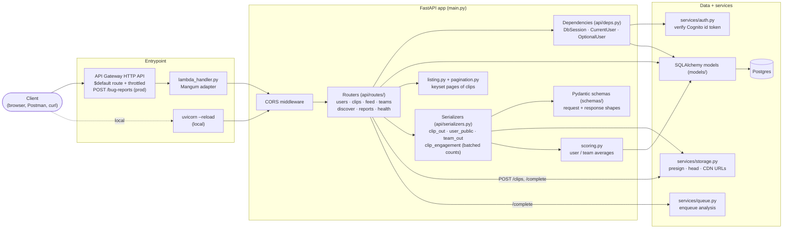
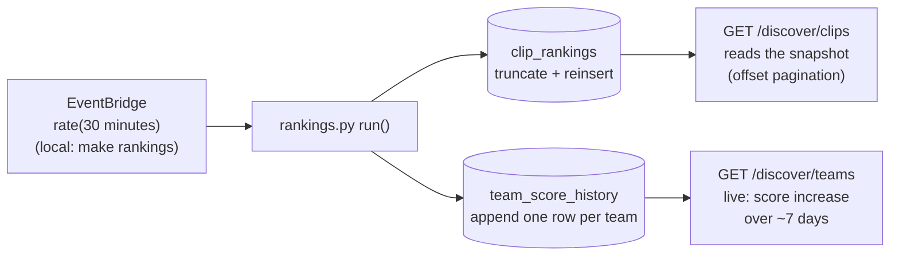

# API

The FastAPI application: authentication, users and profiles, the clip
lifecycle, the social features (follows, feed, likes, comments, teams,
Discover), reports from the app and health checks. Code: `backend/app/main.py`,
`backend/app/api/`, `backend/app/schemas/`, `backend/app/scoring.py`.

← Back to the [architecture overview](../ARCHITECTURE.md).

## Inside the API



A request goes through:

1. **Entrypoint.** In production, API Gateway's `$default` route
   proxies everything to the API Lambda (`POST /bug-reports` has a route
   of its own to the same Lambda, only so it can be throttled, see
   [Reports](#reports)), where `lambda_handler.py`'s
   [Mangum](https://mangum.fastapiexpert.com/) adapter turns the Lambda
   event into an ASGI request. Locally, uvicorn serves the same app with
   hot reload. It's the same code and the same image (see
   [Decisions](../ARCHITECTURE.md#decisions)).
2. **Router.** One module per area in `api/routes/`. Routes stay thin:
   validate, load, check permissions, write.
3. **Dependencies** (`api/deps.py`) inject:
   - `DbSession`: one `AsyncSession` per request, committed on success;
   - `CurrentUser`: verifies the bearer token with `services/auth.py`, then
     loads the matching `users` row. A valid token with no row is a 404
     telling the client to `POST /users`, not a 401;
   - `OptionalUser`: the same for public routes that show extra fields to a
     signed-in viewer. A *present but invalid* token still 401s.
4. **Serializers** (`api/serializers.py`) are the only place ORM objects
   become response schemas. Routes never return ORM objects (CLAUDE.md
   convention). Serializers also build media URLs from stored S3 keys at
   response time, and compute engagement counts and averages.
5. **Services** are the only code that talks to AWS. The clip routes use
   `storage` (presign the upload, check it landed) and `queue` (hand the
   clip to the worker). See the [services doc](services.md).

## Endpoints

| Router | Endpoints |
|---|---|
| `health` | `GET /health` (liveness), `GET /health/deep` (Postgres + schema revision, S3, SQS, Cognito; 503 if any fail) |
| `users` | `POST /users` (JIT registration), `GET/PATCH /users/me`, `PATCH /users/me/profile`, `GET /users/me/drafts`, `GET /users/me/teams`, `GET /users/{username}`, `GET /users/{username}/clips`, `POST/DELETE /users/{username}/follow` |
| `clips` | `POST /clips`, `POST /clips/{id}/complete`, `GET /clips/{id}`, `POST /clips/{id}/tricks`, `PATCH /clips/{id}/team`, `PATCH /clips/{id}/score-inclusion`, `POST /clips/{id}/publish`, `POST/DELETE /clips/{id}/like`, `POST /clips/{id}/view`, `POST/GET /clips/{id}/comments`, `DELETE /clips/{id}/comments/{comment_id}` |
| `feed` | `GET /feed` (keyset-paginated) |
| `teams` | `POST /teams`, `GET/PATCH/DELETE /teams/{slug}`, `GET /teams/{slug}/members`, `PATCH/DELETE /teams/{slug}/members/{username}`, `POST/DELETE /teams/{slug}/join`, `GET /teams/{slug}/join-requests`, `GET /teams/{slug}/join-requests/mine`, `POST /teams/{slug}/join-requests/{username}/accept\|reject`, `POST /teams/{slug}/invites`, `GET /teams/invites/mine`, `POST /teams/{slug}/invites/mine/accept\|reject`, `POST/DELETE /teams/{slug}/follow`, `GET /teams/{slug}/clips` |
| `discover` | `GET /discover/clips?sort=score\|engagement`, `GET /discover/teams` |
| `reports` | `POST /clips/{id}/analysis-reports`, `POST /bug-reports` (signed in or out) |

The full request/response shapes are in the interactive docs at
`http://localhost:8000/docs` while the stack is running. Step-by-step
walkthroughs for every area are in the
[development guide](../development.md#walkthroughs).

**Visibility rule:** something you can't see at all (someone else's draft
clip, an unfounded team you're not part of) is a **404**, never a 403. A 403
would confirm it exists. Acting on something you *can* see but that isn't
in the right state (liking your own draft) is a **409**.

## Clip routes and the lifecycle

The clip routes move a clip through its statuses (the
[lifecycle diagram](../ARCHITECTURE.md#clip-lifecycle) shows all of them):

- `POST /clips` creates a `draft` row and returns a presigned S3 upload URL.
  The browser uploads straight to S3; the bytes never pass through the API.
  `analyze: false` (F4) posts the clip without a score: the worker still
  transcodes and thumbnails it (the raw upload expires after 7 days), then
  sets `analyzed` with no analysis row. `ClipOut.analyze` echoes it.
- `POST /clips/{id}/complete` checks the object actually landed (`head`),
  sets `queued`, commits, *then* enqueues. Committing first matters because
  the worker can receive the message before a still-open transaction would
  have committed.
- The worker takes it from there (see the [analyzer doc](analyzer.md)).
- `POST /clips/{id}/tricks` replaces the clip's tags, 1 to 5, in order.
  Each is a plain name or `{name, analysis_index}`, where `analysis_index`
  says which entry of `analysis.tricks` the tag names (unique, in range,
  so a clip without analysis can't use it). An analyzed clip can be tagged
  once it's `analyzed`; one posted without analysis any time before it's
  published, so the names typed at upload go on straight away. An unknown
  name creates a `tricks` row; there's no alias matching yet.
- `POST /clips/{id}/publish` needs at least one tagged trick.

`video_url` is the `processed/` transcode's CDN URL once the worker has made
one, and until then a presigned URL for the raw upload. `thumb_url` is the
poster frame's CDN URL.

**`analysis`** is the clip's latest analysis (`serializers.analysis_out`):

```json
{
  "model_version": "steeze-v0.2-uncalibrated",
  "confidence": "0.92",
  "steeze_breakdown": {"pop": 77.0, "landing_stability": 81.2, "roll_away": 100.0,
                       "stomp": 61.1, "compactness": 65.8, "catch": 80.0},
  "failure_reason": null,
  "tricks": [{"outcome": "landed", "takeoff_ms": 1250, "touchdown_ms": 1650,
              "confidence": 0.92, "subscores": {"pop": 77.0, "...": "..."}}],
  "created_at": "..."
}
```

- `steeze_breakdown` always has all six subscores, in that order, each
  averaged over the clip's landed tricks. One that was n/a on every landed
  trick (catch for an ollie) is `null`, and the UI shows it as n/a. The
  whole breakdown is `null` when the clip is unanalyzable.
- `tricks` (6c-3) lists what the analyzer found, in clip order:
  `outcome` (`landed`, `bailed`, or why it couldn't be judged, e.g. "trick
  left the frame", "analysis failed for this trick"), the take-off and
  touch-down in ms for jumping to the trick (Stage A's pop and landing
  when Stage B couldn't refine them), its confidence, and `subscores`
  for landed tricks only. It's filled for unanalyzable clips too, so the
  UI can say which trick failed and why. It's empty for analyses without
  `details` (stub analyses before 6c-3, media failures, *analysis
  failed*).
- `analysis.tricks` is not `ClipOut.tricks`: those are the user's tags.
  The analyzer never names a trick. A tag names one with its
  `analysis_index` (F4), and an analyzed trick no tag names is one the
  skater said isn't a trick (a step-off at the end of the clip). Tags from
  before F4 have no index; for them, tag *i* names `analysis.tricks[i]` when
  the counts match (tags keep their order in `clip_tricks.position`). See
  [frontend.md](frontend.md#tagging-tricks).
- The raw measurements behind the subscores stay in `analyses.details`
  ([data-model.md](data-model.md)); they're internal units, not API.

## Feed and Discover

**Home feed: fan-out-on-read.** `GET /feed` queries `clips` directly,
filters to `published`, orders by `(published_at, id)` descending,
keyset-paginated: the response carries a `next_cursor` (`"<published_at>|<id>"`)
that the client passes back as `?cursor=`, becoming `WHERE (published_at, id)
< (?, ?)`. Keyset rather than `OFFSET` because offset pagination degrades
linearly and skips rows when new clips arrive mid-scroll. One extra row is
fetched per page (`LIMIT n+1`) purely to know whether `next_cursor` should be
set. A clip embeds its `author` (a `UserBrief`) so the feed needs no
follow-up lookup per row.

**Team follows (4c)** are folded in as `Clip.user_id.in_(followed users)
OR Clip.team_id.in_(followed teams)` — two `IN` subqueries against `follows`,
not a `JOIN` on that OR condition. A join would emit a clip twice when both
its author *and* its tagged team are followed; de-duping a joined result
afterward is more awkward than just not producing the duplicate in the first
place.

**Every other clip list pages the same way**, through `api/listing.py`'s
`clip_page()`: a user's published clips (`GET /users/{username}/clips`), a
team's (`GET /teams/{slug}/clips`, published clips tagged to it), and your
drafts (`GET /users/me/drafts`, every status but `published`, ordered by
`created_at` since drafts have no `published_at`). The first two are
public; clips taken out of an average are listed too.

Fan-out-on-*write* (precomputed per-user timelines) is the standard answer at
large scale, but it costs a write per follower per post and needs backfill
logic. At this scale it is unjustified complexity.

**Discover: precomputed (4d).**



`app/rankings.py`'s `run()` rebuilds `clip_rankings` (this week's clips,
ranked) and appends one `team_score_history` row per founded team, in a
single pass. Discover is a hot page and ranking live — sorting the whole
`clips` table on every load — would be an expensive query; reading a small
pre-sorted snapshot instead is cheap regardless of how many clips exist.

`GET /discover/clips?sort=score|engagement` reads `clip_rankings` directly,
plain offset-paginated rather than keyset: unlike the home feed, this reads a
snapshot that's frozen between rebuilds, so keyset's usual justification
(rows shifting under a paginating client) doesn't apply, and jumping to an
arbitrary page of a ranked list is a reasonable thing to want. `sort=score`
leaves out `score_included = false` clips; `sort=engagement` doesn't (see
the [data model](data-model.md#design-notes) for the weights).
`GET /discover/teams` is the one live-computed exception — ranked by score
*increase* (latest `team_score_history` snapshot minus the one closest to 7
days earlier, per team), computed at request time because the number of
teams is small enough that this is cheap, unlike sorting every clip. A team
with no snapshot from that far back (brand new) is excluded rather than
credited a fake increase-from-zero, which would otherwise let any
freshly-founded team trivially top the list.

**Same dev/prod trigger split as the worker:** locally, `make rankings`
runs the rebuild on demand; in production an EventBridge rule invokes
`app.rankings.lambda_handler` on a schedule (`rate(30 minutes)` by
default). Nothing runs it automatically in dev — there's no scheduler in
docker-compose.

`average_score` on `GET /users/{username}` and `GET /teams/{slug}` is
computed live by `app/scoring.py` (a user's: uncapped; a team's: its top 10
clips). The rankings job uses the same functions for its snapshots, so the
live number and the history can't drift apart.

## Reports

Two routes for the web app's report forms (docs/components/frontend.md,
[Reports](frontend.md#reports)). Both write a row to `reports`
([data model](data-model.md)) and answer `201 {id, created_at}`. Nothing
is forwarded anywhere else, least of all GitHub issues: the repo is
public. `make reports` reads them ([development guide](../development.md#reading-reports)).

- `POST /clips/{id}/analysis-reports`: your own clip, `analyzed` or
  `unanalyzable`, that was analyzed (404 for someone else's clip, 409 for
  a published one or one with no analysis). The body is what the skater
  says: `problems` (a checklist), `trick_index`, `subscores` and
  `score_direction`, `note`, `share_video`, `app_version`. It has to say
  something (a problem or a note), and `trick_index` must fit
  `analysis.tricks`. The server snapshots the analysis itself (model
  version, score, breakdown, failure reason, `details`, the tags), so a
  later rescore can't change what was reported. Only with `share_video`
  (the skater's consent) does the snapshot record the processed video's
  key. Reporting never changes the clip.
- `POST /bug-reports`: signed in or out (a broken login is a bug too). The
  body is `description` (10 to 4000 characters), `page`, and `context`
  (app version, user agent, window size, theme, API mode). Every field is
  bounded and unknown fields are rejected, since anyone can call it, and
  API Gateway throttles the route as a whole (5 burst, 1 per second;
  [infrastructure](infrastructure.md)). A signed-in report records the
  user.

## Engagement counts

Likes and comments (step 4b) add three fields to `ClipOut`: `like_count`,
`comment_count`, `liked_by_me`. `view_count` (4d, backed by `clip_views` and
`POST /clips/{id}/view`) joined them as a fourth. All four are computed in
`api/serializers.py`'s `clip_out()`, which takes `db` and an optional
`viewer`, plus optional precomputed values for each.

**Single-clip routes** (everything in `routes/clips.py`) let `clip_out`
query directly — one `COUNT` per metric, one lookup for `liked_by_me` — the
same per-call cost `user_public()` already pays for
`follower_count`/`following_count`/`followed_by_me`.

**The feed and Discover are different**: both call `clip_out` in a loop over
up to 50 clips per page, so paying a query per clip per metric there would
mean hundreds of queries per page load. `clip_engagement()` batches all four
into one grouped query per metric for the whole page — `GROUP BY clip_id`
for the three counts, one `IN (...)` lookup for the viewer's likes — and
`feed.py`/`routes/discover.py` pass the results into `clip_out` as
precomputed values, skipping its default per-clip queries entirely.

Comment listing (`GET /clips/{id}/comments`) doesn't need the same
treatment: it returns *comments*, not clips, and a comment's replies load via
`.options(selectinload(Comment.replies))` on the query — SQLAlchemy's own
batched-eager-load strategy, so a page of top-level comments plus every reply
on it is two queries total, not N+1, with no hand-written batching needed.
Note this has to be requested explicitly in the query, unlike
`Clip.analyses`/`Clip.clip_tricks`: SQLAlchemy never auto-applies a
relationship's default `lazy=` strategy when it's self-referential, the way
`Comment.replies` is — see the gotcha in `CLAUDE.md` and the comment on
`Comment.replies` in `app/models/social.py`.

## Health checks

- `GET /health` only says the process is up.
- `GET /health/deep` checks, concurrently, each with its latency:
  - **postgres:** connects, then compares `alembic_version` with the head
    revision in the image's own `alembic/` directory. A mismatch or missing
    table is a failure, so an unmigrated database can't pass;
  - **s3:** the media bucket is reachable;
  - **sqs:** the analysis queue is reachable (also reports waiting and
    in-flight messages);
  - **cognito:** the pool's JWKS can be fetched.

  Any failure turns the response into a 503 and names the dependency and
  error. The deploy pipeline's smoke test is this endpoint (see
  [infrastructure](infrastructure.md#cicd-pipeline)).

## Logging

`main.py` calls `app.logs.configure_logging()` at import, like every other
entrypoint, so INFO lines reach CloudWatch under Lambda as well as the
terminal locally (see [Decisions](../ARCHITECTURE.md#decisions)).
