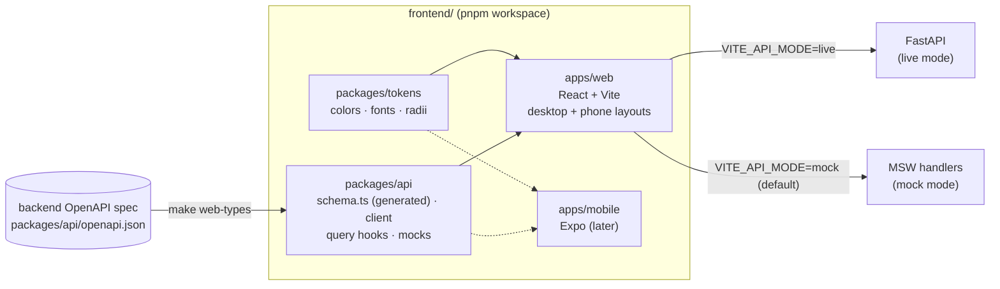

# Frontend (web app)

The TrickLens web app in `frontend/`: one React app for desktop and phone
browsers, plus the packages a native app will share later.

← [Architecture](../ARCHITECTURE.md) · [Development guide](../development.md)

**Status:** phases F1 (scaffold), F2 (read screens) and F3 (upload and
team flows) are done, all against the mock API. What's left is F4: real
Cognito, the live API, and hosting. The design itself lives on the design canvas, a
claude.ai artifact ("TrickLens Login Directions"), with desktop (1440px) and
phone (390px) artboards for every screen in light and dark.

## How it fits together



## Why this stack

- **One web app for desktop and phone browsers.** The phone artboards on the
  canvas are the web app at phone width, not a separate app. Layout changes
  by width (see [Responsive layout](#responsive-layout)); the code is shared.
- **React + TypeScript, built with Vite, as a static single-page app.** The
  API is already a separate FastAPI service and nothing needs server
  rendering, so the build is static files that can sit on S3 + CloudFront
  like the media. Next.js would only earn its place if public clip pages
  needed search-engine indexing.
- **A native app later, sharing logic but not screens.** It will be React
  Native (Expo) in `apps/mobile`, reusing `@tricklens/api` (types, client,
  query hooks, mocks) and `@tricklens/tokens`. Screens stay separate: a
  shared-UI approach (React Native Web) would make the website feel like a
  stretched phone app, and video, upload and the desktop layouts all fight
  it.
- **pnpm workspace from day one**, so adding `apps/mobile` moves nothing.
- **TanStack Query** for server state (works in React Native too),
  **React Router** for routes, **CSS Modules** plus token variables for
  styling, **MSW** for the mock API, **Vitest + Testing Library** for tests,
  **Biome** for lint and format (one tool instead of an ESLint setup).
- **TypeScript is pinned to 5.9.** TypeScript 7 exists, but
  `openapi-typescript` (which generates the API types) only supports 5.x.
- **Supply-chain guard:** `pnpm-workspace.yaml` sets
  `minimumReleaseAge` to 14 days, so pnpm never installs a version
  published more recently than that.

## Workspace layout

```
frontend/
├── package.json, pnpm-workspace.yaml, tsconfig.base.json, biome.json
├── apps/web/
│   ├── index.html            pre-paint theme script
│   ├── public/               favicon, mockServiceWorker.js (generated by msw)
│   └── src/
│       ├── main.tsx          fonts, token CSS, mock API, render
│       ├── router.tsx        every route
│       ├── env.ts            VITE_API_MODE / VITE_API_URL
│       ├── app/              providers: theme, auth, API client, data cache
│       ├── layouts/          AppShell (top nav ↔ bottom tabs), AuthLayout
│       ├── routes/           one folder per screen area: auth/, feed/, clips/,
│       │                     discover/, profile/, settings/ (+ F3 placeholders)
│       ├── components/
│       │   ├── ui/           Button, Avatar, Logo, Field, Segmented, Pills,
│       │   │                 Switch, Chip, loading/error/empty states
│       │   ├── clip/         ClipMedia, score sticker, subscore strip and bars,
│       │   │                 actions, PostCard, TrickBreakdown
│       │   ├── comments/     thread, composer, side panel / bottom sheet
│       │   └── icons/
│       ├── styles/           global.css
│       └── test/             setup (MSW in Node), renderApp()
└── packages/
    ├── tokens/               design tokens + themeCss()
    └── api/
        ├── openapi.json      snapshot of the backend spec
        ├── src/schema.ts     generated from it; never edited by hand
        ├── src/client.ts     typed fetch client + bearer token
        ├── src/queries/      feed, clips, comments, discover, users;
        │                     proposed.ts for routes the API lacks
        ├── src/subscores.ts  the six subscores' order, labels and notes
        └── src/mocks/        sample data, in-memory state, MSW handlers
```

## Design tokens

`@tricklens/tokens` is the single source for color, type and shape. Three
brand colors each carry one meaning:

| Color | Hex | Means |
|---|---|---|
| Light Yellow | `#FEF0B6` | Scores: steeze stickers, averages |
| Light Azure | `#BBD3E0` | Selection and social: active nav, Following, Approve |
| Dark Gray Brown | `#472F26` | Ink and primary actions |

A muted red is the one extra color, used only for errors and destructive
actions. `themes.light` and `themes.dark` define the same token names;
`themeCss()` turns them into CSS variables (`--bg`, `--ink`, `--primary`,
…), which `main.tsx` injects before the app renders. The primary action
inverts between themes: brown with yellow text in light, yellow with brown
text in dark.

Fonts are self-hosted from `@fontsource` packages, not Google Fonts:
**Bricolage Grotesque** (display), **Barlow** (body), **DM Mono** (labels and
numbers).

### Themes

The viewer picks Light, Dark or Match system in Settings → Appearance. The
choice is stored in `localStorage` (`tricklens:theme`) and applied as
`data-theme` on `<html>`; "Match system" removes the attribute and the CSS
follows `prefers-color-scheme`. An inline script in `index.html` applies a
saved choice before first paint, so there's no flash of the wrong theme.

## Responsive layout

One `AppShell` renders both layouts and CSS picks one at **900px**
(`breakpoints.desktop` in the tokens; CSS media queries can't read it, so
the two are kept in sync by hand):

- **Phone (< 900px):** slim top bar, fixed bottom tab bar (Feed, Discover,
  Upload, Teams, Profile), safe-area insets respected for notched phones.
- **Desktop (≥ 900px):** top nav with the same five sections, Settings gear
  and the signed-in user.

Components are written phone-first and widen at the same breakpoint.

## Routes

| Path | Screen | Phase |
|---|---|---|
| `/login`, `/signup` | Log in; sign up with the emailed-code step | **done** (F2) |
| `/` | Redirects to `/feed` | — |
| `/feed` | Home feed with comments | **done** (F2) |
| `/discover` | Top clips (`?sort=`) and rising teams (`?tab=` on phones) | **done** (F2) |
| `/upload` | Pick or record a clip, analyze or not, upload; your unpublished clips | **done** (F3) |
| `/upload/:clipId` | Status, then review: name each trick, team, score inclusion, publish | **done** (F3) |
| `/clips/:clipId` | Clip detail: single, multi-trick, couldn't-score | **done** (F2) |
| `/profile`, `/profile/edit` | Your profile and the edit form | **done** (F2) |
| `/u/:username` | Another skater, with Follow | **done** (F2) |
| `/teams`, `/teams/new` | Your teams and invites; create a team (basics, founders, review) | **done** (F3) |
| `/t/:slug`, `/t/:slug/settings` | A team (forming or live), and its owner's settings | **done** (F3) |
| `/settings` | Appearance, account, help | **done** (F1) |
| `/report-bug` | Report a bug (signed in or out) | **done** (F3) |

Everything except `/login` and `/signup` sits behind `RequireAuth`.

## Screens

How the screens map the design onto the API:

- **Feed** (`GET /feed`, keyset pages): each post shows the score sticker
  and the six-subscore strip (n/a where a subscore doesn't apply), likes
  (optimistic), comments, views (a play records one, `POST /clips/{id}/view`)
  and copy-link. Comments open beside the feed on desktop and as a modal
  bottom sheet on phones (Escape closes it, focus returns).
- **Comments**: newest first, one level of replies like the API. Replying to
  a reply posts into the same thread with the handle prefilled. Threads fold
  after two replies, and posting a reply unfolds its thread. You can delete
  your own comments, and the clip's owner can delete any on their clip, with
  an inline confirmation that says how many replies go with it.
- **Clip detail**: the breakdown with what each subscore measures. A clip
  with several tricks shows the analyzer's tricks in clip order with a
  timeline; bails aren't scored. Rows are named by the skater's tags when
  there's one tag per analyzed trick (see [Tagging tricks](#tagging-tricks)),
  numbered otherwise. On your own clip, a switch takes the score out
  of your average (`PATCH /clips/{id}/score-inclusion`). Your own clip that
  couldn't be scored shows the reason and what to try next.
- **Discover**: ranked clips by score or activity, and rising teams. Both
  columns on desktop; a Clips/Teams switch on phones. Sort and tab live in
  the URL.
- **Profiles**: stats, setup, and a clip grid ("Not counted" clips marked).
  Follow is optimistic. Your own username redirects to `/profile`.
- **Edit profile**: name, bio and setup, checked against the API's limits
  (board 6–12 in, wheels 40–80 mm). Saves `PATCH /users/me/profile` then
  `PATCH /users/me`.
- **Log in / sign up**: real forms with validation. Sign-up checks the
  username rule and Cognito's default password policy (8+ characters, upper
  and lower case, a number, a symbol), then asks for the 6-digit code
  Cognito emails, then registers with the API (`POST /users`). The design
  had no code step; Cognito requires one.

- **Upload** (F3): pick a clip (MP4, MOV or WebM, up to 30s, checked in
  the browser) or record one on a phone; drag and drop on desktop. "Analyze
  the clip" is on by default. With it off you name the tricks right away
  and the clip posts without a score (a proposed API change, see
  [Endpoints the API doesn't have yet](#endpoints-the-api-doesnt-have-yet)).
  The file goes straight to S3 with the presigned URL, with a progress bar
  (XHR, since fetch can't report upload progress). Clips you haven't
  published are listed under In progress.
- **Clip status and review** (`/upload/:clipId`): polls the clip every 2s
  while it's queued or analyzing, with a stepper. When it's ready: the
  score and breakdown, then one name field per analyzed trick in clip order,
  each with a button that jumps the video to that trick, plus "Tag to a
  team" (your teams only) and "Include this score". Publish runs the API's
  pre-publish calls in order: tricks, team, score inclusion, publish. A
  clip that couldn't be scored shows the reason and what to change. Your
  own upload plays from the local file for the session, before (or, in
  mock mode, instead of) the processed video.
- **Teams** (F3): your teams and pending invites; creating a team in three
  steps (basics, then founding members added by exact username since the
  API has no user search, then review), with a taken address sending you
  back to fix it. A team that's still forming shows the owner who has
  accepted and lets them cancel; a founding invitee gets accept or decline,
  warned that declining cancels the team for everyone. A live team has
  follow, a join control by policy (join, request / request sent and
  withdraw, or invite only), leave, members with an owner/admin menu (make
  admin or member, remove after confirming), inviting by username, join
  requests to approve, and the team's clips. Settings (owner only) edits
  everything but the address and deletes the team after you type its name.

### Tagging tricks

Decided with the user (2026-10-26): tricks are named **after** analysis,
one name per trick the analyzer found, in the order it found them, so a
three-trick line gets three names (bails included: name the trick you went
for). The API already stores tags in order (`clip_tricks.position`), so
tag *i* names `analysis.tricks[i]` whenever the counts match; the clip page
relies on that to label its per-trick rows. With analysis off there's
nothing to match, so the skater names 1 to 5 tricks up front. The API caps a
clip at 5 tags, so a clip where the analyzer finds more can't be published
yet (the review says so). The API stores names lowercased; the UI shows them
capitalized (`formatTrickName`).

## Reports

Two ways to tell the TrickLens team something's wrong, added 2026-10-26
with the user (who chose every option below). Both go to proposed API
routes (see [Endpoints the API doesn't have yet](#endpoints-the-api-doesnt-have-yet));
the backend half is part of F4.

**Report a problem with this analysis.** The analyzer is tuned on very few
clips, so these reports show where it falls short on other people's
footage. It's a link on your own clip's review step (scored) and on the
couldn't-score screen, and only for clips that were analyzed. It opens a
dialog:

- *What went wrong?* A checklist that fits the result. Scored: it missed a
  trick, found one that isn't there, called a landing or bail wrong, picked
  the wrong moment, or the score feels off. Couldn't score: I landed it but
  it couldn't score it, the reason doesn't fit, it missed a trick.
- *Which trick?* (when the clip has several and the problem is about one),
  and for a score that feels off, *which parts* and whether *too high* or
  *too low*.
- An optional note.
- A consent checkbox, **off by default**: "Let TrickLens keep and watch this
  clip to improve the analyzer." Without it the report carries only what
  the skater wrote plus the analysis numbers, not the video.

After sending, the dialog says the report was sent, and its button returns
you to the clip exactly as you left it (typed trick names included).
Reporting never changes the score and never blocks publishing. The server
is meant to snapshot the analysis itself (model version, per-trick
results, `analyses.details`), so the request carries only what the skater
says. The video the analyzer ran on is the `processed/` transcode, which
isn't deleted (the original upload in `raw/` expires after 7 days).

**Report a bug.** Anything wrong with the app itself. It's always one tap
away: a bug icon in the header on every screen, a Help card in Settings, a
link on the login and signup screens (it works signed out, for a broken
login), and a link on every error message, which quotes the error into the
report. It asks what went wrong and where (prefilled with the page you came
from), and sends the app version, browser, window size and theme with it,
listed on the page under "What's sent with your report". Afterwards it
links back to where you were.

**Where reports go.** Never to GitHub: the repo is public. F4 adds a
`reports` table (kind, user, clip, the body above, the analysis snapshot,
`share_video`, created time), the two routes, and a way to read them
(`make reports`, then an admin view if it's needed). A clip shared in an
analysis report is the input `make calibrate` (6d) already understands.

All data goes through `@tricklens/api` hooks. A like, a comment or a score
switch updates the clip in every cached list at once (`patchClip`), so
the feed, Discover, profiles and the clip page never disagree.

## API types

The frontend never hand-writes API types. `make web-types` dumps the
backend's OpenAPI spec (from the `api` image, no running server needed)
into `packages/api/openapi.json` and regenerates `src/schema.ts` from it.
Both are committed. The typed client (`openapi-fetch`) checks every path,
parameter, body and response against them, so an API change that breaks
the frontend fails `pnpm typecheck`.

Two CI checks keep them honest: the backend job fails if the spec changed
without `make web-types`, and the web job fails if `schema.ts` doesn't match
`openapi.json`.

The API sends Decimal fields (`steeze_score`, `average_score`,
`confidence`) as JSON strings like `"79.50"`. `toNumber`, `formatScore`
and `formatAverage` in `@tricklens/api` parse them; components never do.

## Mock mode

By default the app runs against **MSW** (Mock Service Worker): a service
worker answers every API call with sample data from
`packages/api/src/mocks/`. The real client, hooks, loading and error states
all run; only the server is fake. The sample data is typed against the
generated schema, so it can't drift from the real API's shape.

- `VITE_API_MODE=mock` (default) or `live`, and `VITE_API_URL` (default
  `http://localhost:8000`), in `apps/web/.env.local`.
- The same handlers serve the Node tests (`msw/node`).
- MSW is loaded with a dynamic import only in mock mode, so it lands in its
  own chunk and stays out of a live build's main bundle.
- The handlers keep in-memory state (`mocks/db.ts`), so likes, follows,
  comments and profile edits stick until the page reloads; tests reset it
  between cases. They follow the API's rules: who can delete a comment,
  one level of replies, no liking unpublished clips, the owner's own views
  not counted, Discover's ranking rules.
- The sample data is the design canvas's: the skaters, Downtown Skaters
  and four more teams (one per join policy), a team still forming that
  `@juliavance` is invited to found, a three-trick line with a bail and an
  n/a catch, and a clip that couldn't be scored. Sample clips have no video
  file, so pressing play says so.
- Uploads go through a simulated worker: a completed upload is queued for
  1.5s, analyzing for 4.5s, then analyzed or unanalyzable (instant in
  tests). In mock mode the upload page has a "Prototype: what the analyzer
  finds" picker (one trick, a three-trick line, or couldn't score), so every
  outcome can be tried. The mock's "S3" answers the browser's CORS preflight
  like the real bucket.

### Endpoints the API doesn't have yet

Where a screen needs an endpoint the API lacks, the frontend calls a
**proposed** route, shaped like the existing ones, that only the mock
answers. It lives in `packages/api/src/queries/proposed.ts` with its own
typed path, so nothing else changes when the backend adds it: `make
web-types` brings it into `schema.ts` and the hook moves to the typed
client. Currently:

- `GET /users/{username}/clips`: a user's published clips, newest first,
  keyset-paginated like `/feed`. Profiles use it for the clip grid.
- `POST /clips` with `analyze: false`: skip the analyzer. `complete` then
  moves the clip straight to `analyzed` with no analysis and no score, so
  it can be tagged and published. The API ignores the field today.
- `GET /users/me/drafts`: your unpublished clips, so one left mid-analysis
  can be found again.
- `GET /users/me/teams`: your teams with your role, for the Teams tab and
  "Tag to a team".
- `GET /teams/{slug}/clips`: a team's published clips.
- `GET /teams/{slug}/join-requests/mine`: `{ pending: false }` or
  `{ pending: true, created_at }`, so "Request sent" survives a reload
  (`TeamOut` doesn't say).
- `POST /clips/{clip_id}/analysis-reports`: your own clip, `analyzed` or
  `unanalyzable`, with an analysis. Body: `problems`, `trick_index`,
  `subscores`, `score_direction`, `note`, `share_video`, `app_version`.
  201 `{ id, created_at }`. See [Reports](#reports).
- `POST /bug-reports`: signed in or out. Body: `description`, `page`, and
  `context` (`app_version`, `user_agent`, `viewport`, `theme`, `api_mode`).
  201 `{ id, created_at }`.

Auth is a mock too: a fake session, signed in by default as the sample user
`@juliavance`. Phase 4 replaces it with Cognito behind the same
`useAuth()` interface.

## Build phases

The frontend is a parallel track to the backend's numbered steps. Phases 1–3
need nothing new from the backend; phase 4 waits until step 6c is done.

| Phase | Scope | Status |
|---|---|---|
| F1 | Workspace, tokens, fonts, both themes + Settings toggle, AppShell, routes, typed API client from OpenAPI, MSW, CI | **done** |
| F2 | Auth screens (mocked), feed + comments, Discover, clip detail incl. multi-trick, profiles, edit profile | **done** |
| F3 | Upload → status → review → publish (simulated worker), per-trick tagging, analysis on/off, the team flow | **done** |
| F4 | Real Cognito auth, live API, the proposed routes on the backend (including the `reports` table and `make reports`), presigned uploads, CORS, hosting (S3 + CloudFront via Terraform) and deploy in `deploy.yml` (setting `VITE_APP_VERSION`) | after 6c |
| later | `apps/mobile` (Expo) reusing `api` and `tokens` | |

## Known gaps between the design and the API

Kept here until the backend reaches MVP. The screens are built around them:

- **No endpoint lists a user's clips.** Built against the proposed
  `GET /users/{username}/clips` (see
  [Endpoints the API doesn't have yet](#endpoints-the-api-doesnt-have-yet)).
- **No captions, by decision** (2026-10-26): the user doesn't plan to add
  them, so the design's captions are dropped rather than waiting on the API.
- **No avatar upload, and usernames can't change.** Edit profile says so;
  the photo shows initials.
- **A user's teams aren't on their profile** (`UserPublic` has none), so
  the profile's team line is left out. Team rankings carry only the team's
  name and slug, so Discover leaves out the level chip.
- **Upload visibility (Public/Followers)** isn't in the API; left off the
  upload screen for now (decided 2026-10-26). Published clips are public.
- **Skipping analysis** needs the proposed `analyze` flag; until the API
  has it, a live upload is always analyzed.
- **More than 5 tricks in one clip** can't be tagged (the API takes 1 to 5),
  so such a clip can't be published.
- **No user search**: founders and invites are added by exact username.
- **"Request sent", your teams, your drafts and team clips** all need the
  proposed routes above.
- **No way to delete a clip**, so one that couldn't be scored stays in In
  progress. Team slugs use underscores (`downtown_skaters`) as the API
  requires; the canvas's older desktop team screens showed a hyphen.

## Tests

`make web-test` runs every package's Vitest suite in the `web` container:

- `packages/tokens`: both themes define the same tokens; the CSS covers
  the OS setting and the explicit choice.
- `packages/api`: the real client and hooks against the mock handlers
  (bearer token, error detail → `ApiError`), Decimal parsing.
- `apps/web` (64 tests): the whole app in a memory router against the mock
  API, one file per screen area: the shell and Settings; log-in and sign-up
  validation and the code step; the feed's order, n/a subscores, likes and
  views; comments (sheet, folded threads, replying, deleting, Escape);
  clip detail (single, multi-trick named by its tags, the score switch
  persisting, couldn't-score, not found); Discover's two sorts and the teams
  tab; profiles, follow, and editing with the API's limits; upload (file
  checks, a line named trick by trick through to the clip page, analysis
  off, couldn't score, In progress, the waiting state); teams (list and
  invites, the create flow and a taken address, founding accept and
  decline, owner and admin actions, join by each policy, leave, follow,
  team clips, settings and delete); reports (an analysis report sent and
  back to publishing with nothing published, the video only with consent,
  the couldn't-score choices, none without an analysis; a bug report from
  the header, from an error it quotes, and signed out).

The QueryClient doesn't retry 4xx responses (a 404 won't change on retry),
only server and network errors.

`make web-check` is what CI runs: Biome, the schema drift check, typecheck,
tests and a production build.
