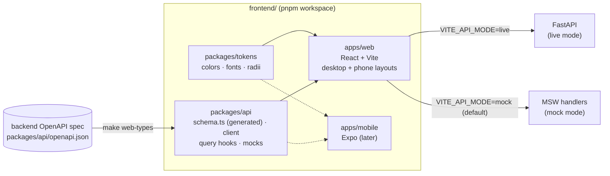

# Frontend (web app)

The TrickLens web app in `frontend/`: one React app for desktop and phone
browsers, plus the packages a native app will share later.

← [Architecture](../ARCHITECTURE.md) · [Development guide](../development.md)

**Status:** phases F1 (scaffold) and F2 (read screens) are done. Log in and
sign up, the feed with comments, Discover, clip detail (single and
multi-trick), profiles, editing your profile and Settings all run against the
mock API. Upload and the team screens (F3) are placeholders that name their
design. The design itself lives on the design canvas, a
claude.ai artifact ("TrickLens Login Directions"), with desktop (1440px) and
phone (390px) artboards for every screen in light and dark.

## How it fits together



## Why this stack

- **One web app for desktop and phone browsers.** The phone artboards on the
  canvas are the web app at phone width, not a separate app. Layout changes
  by width (see [Responsive layout](#responsive-layout)); the code is shared.
- **React + TypeScript, built with Vite, as a static single-page app.** The
  API is already a separate FastAPI service and nothing needs server
  rendering, so the build is static files that can sit on S3 + CloudFront
  like the media. Next.js would only earn its place if public clip pages
  needed search-engine indexing.
- **A native app later, sharing logic but not screens.** It will be React
  Native (Expo) in `apps/mobile`, reusing `@tricklens/api` (types, client,
  query hooks, mocks) and `@tricklens/tokens`. Screens stay separate: a
  shared-UI approach (React Native Web) would make the website feel like a
  stretched phone app, and video, upload and the desktop layouts all fight
  it.
- **pnpm workspace from day one**, so adding `apps/mobile` moves nothing.
- **TanStack Query** for server state (works in React Native too),
  **React Router** for routes, **CSS Modules** plus token variables for
  styling, **MSW** for the mock API, **Vitest + Testing Library** for tests,
  **Biome** for lint and format (one tool instead of an ESLint setup).
- **TypeScript is pinned to 5.9.** TypeScript 7 exists, but
  `openapi-typescript` (which generates the API types) only supports 5.x.
- **Supply-chain guard:** `pnpm-workspace.yaml` sets
  `minimumReleaseAge` to 14 days, so pnpm never installs a version
  published more recently than that.

## Workspace layout

```
frontend/
├── package.json, pnpm-workspace.yaml, tsconfig.base.json, biome.json
├── apps/web/
│   ├── index.html            pre-paint theme script
│   ├── public/               favicon, mockServiceWorker.js (generated by msw)
│   └── src/
│       ├── main.tsx          fonts, token CSS, mock API, render
│       ├── router.tsx        every route
│       ├── env.ts            VITE_API_MODE / VITE_API_URL
│       ├── app/              providers: theme, auth, API client, data cache
│       ├── layouts/          AppShell (top nav ↔ bottom tabs), AuthLayout
│       ├── routes/           one folder per screen area: auth/, feed/, clips/,
│       │                     discover/, profile/, settings/ (+ F3 placeholders)
│       ├── components/
│       │   ├── ui/           Button, Avatar, Logo, Field, Segmented, Pills,
│       │   │                 Switch, Chip, loading/error/empty states
│       │   ├── clip/         ClipMedia, score sticker, subscore strip and bars,
│       │   │                 actions, PostCard, TrickBreakdown
│       │   ├── comments/     thread, composer, side panel / bottom sheet
│       │   └── icons/
│       ├── styles/           global.css
│       └── test/             setup (MSW in Node), renderApp()
└── packages/
    ├── tokens/               design tokens + themeCss()
    └── api/
        ├── openapi.json      snapshot of the backend spec
        ├── src/schema.ts     generated from it; never edited by hand
        ├── src/client.ts     typed fetch client + bearer token
        ├── src/queries/      feed, clips, comments, discover, users;
        │                     proposed.ts for routes the API lacks
        ├── src/subscores.ts  the six subscores' order, labels and notes
        └── src/mocks/        sample data, in-memory state, MSW handlers
```

## Design tokens

`@tricklens/tokens` is the single source for color, type and shape. Three
brand colors each carry one meaning:

| Color | Hex | Means |
|---|---|---|
| Light Yellow | `#FEF0B6` | Scores: steeze stickers, averages |
| Light Azure | `#BBD3E0` | Selection and social: active nav, Following, Approve |
| Dark Gray Brown | `#472F26` | Ink and primary actions |

A muted red is the one extra color, used only for errors and destructive
actions. `themes.light` and `themes.dark` define the same token names;
`themeCss()` turns them into CSS variables (`--bg`, `--ink`, `--primary`,
…), which `main.tsx` injects before the app renders. The primary action
inverts between themes: brown with yellow text in light, yellow with brown
text in dark.

Fonts are self-hosted from `@fontsource` packages, not Google Fonts:
**Bricolage Grotesque** (display), **Barlow** (body), **DM Mono** (labels and
numbers).

### Themes

The viewer picks Light, Dark or Match system in Settings → Appearance. The
choice is stored in `localStorage` (`tricklens:theme`) and applied as
`data-theme` on `<html>`; "Match system" removes the attribute and the CSS
follows `prefers-color-scheme`. An inline script in `index.html` applies a
saved choice before first paint, so there's no flash of the wrong theme.

## Responsive layout

One `AppShell` renders both layouts and CSS picks one at **900px**
(`breakpoints.desktop` in the tokens; CSS media queries can't read it, so
the two are kept in sync by hand):

- **Phone (< 900px):** slim top bar, fixed bottom tab bar (Feed, Discover,
  Upload, Teams, Profile), safe-area insets respected for notched phones.
- **Desktop (≥ 900px):** top nav with the same five sections, Settings gear
  and the signed-in user.

Components are written phone-first and widen at the same breakpoint.

## Routes

| Path | Screen | Phase |
|---|---|---|
| `/login`, `/signup` | Log in; sign up with the emailed-code step | **done** (F2) |
| `/` | Redirects to `/feed` | — |
| `/feed` | Home feed with comments | **done** (F2) |
| `/discover` | Top clips (`?sort=`) and rising teams (`?tab=` on phones) | **done** (F2) |
| `/upload` | Upload, status, review, publish | F3 |
| `/clips/:clipId` | Clip detail: single, multi-trick, couldn't-score | **done** (F2) |
| `/profile`, `/profile/edit` | Your profile and the edit form | **done** (F2) |
| `/u/:username` | Another skater, with Follow | **done** (F2) |
| `/teams`, `/t/:slug` | Teams | F3 |
| `/settings` | Appearance, account | **done** (F1) |

Everything except `/login` and `/signup` sits behind `RequireAuth`.

## Screens

How the F2 screens map the design onto the API:

- **Feed** (`GET /feed`, keyset pages): each post shows the score sticker
  and the six-subscore strip (n/a where a subscore doesn't apply), likes
  (optimistic), comments, views (a play records one, `POST /clips/{id}/view`)
  and copy-link. Comments open beside the feed on desktop and as a modal
  bottom sheet on phones (Escape closes it, focus returns).
- **Comments**: newest first, one level of replies like the API. Replying to
  a reply posts into the same thread with the handle prefilled. Threads fold
  after two replies, and posting a reply unfolds its thread. You can delete
  your own comments, and the clip's owner can delete any on their clip, with
  an inline confirmation that says how many replies go with it.
- **Clip detail**: the breakdown with what each subscore measures. A clip
  with several tricks shows the analyzer's tricks in clip order with a
  timeline; bails aren't scored. The analyzer doesn't name tricks and
  nothing matches them to the skater's tags, so rows are numbered and the
  tags are shown separately. On your own clip, a switch takes the score out
  of your average (`PATCH /clips/{id}/score-inclusion`). Your own clip that
  couldn't be scored shows the reason and what to try next.
- **Discover**: ranked clips by score or activity, and rising teams. Both
  columns on desktop; a Clips/Teams switch on phones. Sort and tab live in
  the URL.
- **Profiles**: stats, setup, and a clip grid ("Not counted" clips marked).
  Follow is optimistic. Your own username redirects to `/profile`.
- **Edit profile**: name, bio and setup, checked against the API's limits
  (board 6–12 in, wheels 40–80 mm). Saves `PATCH /users/me/profile` then
  `PATCH /users/me`.
- **Log in / sign up**: real forms with validation. Sign-up checks the
  username rule and Cognito's default password policy (8+ characters, upper
  and lower case, a number, a symbol), then asks for the 6-digit code
  Cognito emails, then registers with the API (`POST /users`). The design
  had no code step; Cognito requires one.

All data goes through `@tricklens/api` hooks. A like, a comment or a score
switch updates the clip in every cached list at once (`patchClip`), so
the feed, Discover, profiles and the clip page never disagree.

## API types

The frontend never hand-writes API types. `make web-types` dumps the
backend's OpenAPI spec (from the `api` image, no running server needed)
into `packages/api/openapi.json` and regenerates `src/schema.ts` from it.
Both are committed. The typed client (`openapi-fetch`) checks every path,
parameter, body and response against them, so an API change that breaks
the frontend fails `pnpm typecheck`.

Two CI checks keep them honest: the backend job fails if the spec changed
without `make web-types`, and the web job fails if `schema.ts` doesn't match
`openapi.json`.

The API sends Decimal fields (`steeze_score`, `average_score`,
`confidence`) as JSON strings like `"79.50"`. `toNumber`, `formatScore`
and `formatAverage` in `@tricklens/api` parse them; components never do.

## Mock mode

By default the app runs against **MSW** (Mock Service Worker): a service
worker answers every API call with sample data from
`packages/api/src/mocks/`. The real client, hooks, loading and error states
all run; only the server is fake. The sample data is typed against the
generated schema, so it can't drift from the real API's shape.

- `VITE_API_MODE=mock` (default) or `live`, and `VITE_API_URL` (default
  `http://localhost:8000`), in `apps/web/.env.local`.
- The same handlers serve the Node tests (`msw/node`).
- MSW is loaded with a dynamic import only in mock mode, so it lands in its
  own chunk and stays out of a live build's main bundle.
- The handlers keep in-memory state (`mocks/db.ts`), so likes, follows,
  comments and profile edits stick until the page reloads; tests reset it
  between cases. They follow the API's rules: who can delete a comment,
  one level of replies, no liking unpublished clips, the owner's own views
  not counted, Discover's ranking rules.
- The sample data is the design canvas's: the skaters, Downtown Skaters,
  a three-trick line with a bail and an n/a catch, and a clip that couldn't
  be scored. Sample clips have no video file, so pressing play says so.

### Endpoints the API doesn't have yet

Where a screen needs an endpoint the API lacks, the frontend calls a
**proposed** route, shaped like the existing ones, that only the mock
answers. It lives in `packages/api/src/queries/proposed.ts` with its own
typed path, so nothing else changes when the backend adds it: `make
web-types` brings it into `schema.ts` and the hook moves to the typed
client. Currently:

- `GET /users/{username}/clips`: a user's published clips, newest first,
  keyset-paginated like `/feed`. Profiles use it for the clip grid.

Auth is a mock too: a fake session, signed in by default as the sample user
`@juliavance`. Phase 4 replaces it with Cognito behind the same
`useAuth()` interface.

## Build phases

The frontend is a parallel track to the backend's numbered steps. Phases 1–3
need nothing new from the backend; phase 4 waits until step 6c is done.

| Phase | Scope | Status |
|---|---|---|
| F1 | Workspace, tokens, fonts, both themes + Settings toggle, AppShell, routes, typed API client from OpenAPI, MSW, CI | **done** |
| F2 | Auth screens (mocked), feed + comments, Discover, clip detail incl. multi-trick, profiles, edit profile | **done** |
| F3 | Upload → status → review → publish (mock state machine), the team flow | |
| F4 | Real Cognito auth, live API, presigned uploads, CORS, hosting (S3 + CloudFront via Terraform) and deploy in `deploy.yml` | after 6c |
| later | `apps/mobile` (Expo) reusing `api` and `tokens` | |

## Known gaps between the design and the API

Kept here until the backend reaches MVP. The screens are built around them:

- **No endpoint lists a user's clips.** Built against the proposed
  `GET /users/{username}/clips` (see
  [Endpoints the API doesn't have yet](#endpoints-the-api-doesnt-have-yet)).
- **Clips have no caption.** The design's captions under posts are left
  out until `ClipOut` has one.
- **No avatar upload, and usernames can't change.** Edit profile says so;
  the photo shows initials.
- **A user's teams aren't on their profile** (`UserPublic` has none), so
  the profile's team line is left out. Team rankings carry only the team's
  name and slug, so Discover leaves out the level chip.
- **The analyzer's tricks aren't matched to the skater's tags**, so the
  multi-trick breakdown numbers its rows instead of naming them.
- **Upload's Public/Followers choice** isn't in the API; clips are public
  once published. (F3)
- **Trick tagging timing:** the design tags the trick at upload; the API
  tags after analysis (`POST /clips/{id}/tricks`, before publish). (F3)
- **Team slugs** use underscores (`downtown_skaters`); the API rejects
  hyphens. The canvas's older desktop team screens showed a hyphen. (F3)

## Tests

`make web-test` runs every package's Vitest suite in the `web` container:

- `packages/tokens`: both themes define the same tokens; the CSS covers
  the OS setting and the explicit choice.
- `packages/api`: the real client and hooks against the mock handlers
  (bearer token, error detail → `ApiError`), Decimal parsing.
- `apps/web` (36 tests): the whole app in a memory router against the mock
  API, one file per screen area: the shell and Settings; log-in and sign-up
  validation and the code step; the feed's order, n/a subscores, likes and
  views; comments (sheet, folded threads, replying, deleting, Escape);
  clip detail (single, multi-trick, the score switch persisting,
  couldn't-score, not found); Discover's two sorts and the teams tab;
  profiles, follow, and editing with the API's limits.

The QueryClient doesn't retry 4xx responses (a 404 won't change on retry),
only server and network errors.

`make web-check` is what CI runs: Biome, the schema drift check, typecheck,
tests and a production build.
