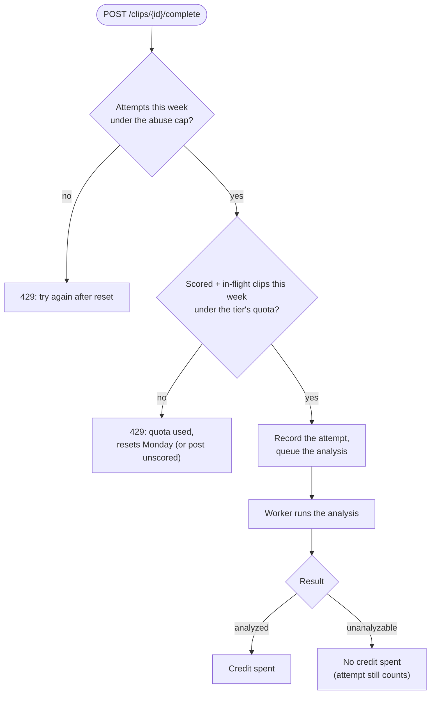

# Subscriptions and analysis limits

**Status: planned, not built.** This is the plan for weekly analysis
limits and paid subscriptions. Nothing here exists in the code yet. It is
scheduled as step 7, after the real analyzer (step 6) ships (see the
[build order](ARCHITECTURE.md#build-order)).

← Back to the [architecture overview](ARCHITECTURE.md).

## Why

Every analysis runs on the worker Lambda, the only part of the system
whose cost grows with how much people *use* it rather than how many
people sign up. A free, unlimited analyzer is fine at today's volume but
unbounded at scale. So:

- free users get a weekly number of **scored clips**;
- a monthly subscription raises that number and unlocks profile
  customization (fonts, colours, backgrounds), which comes later.

## What an analysis costs

The worker Lambda is 3008 MB on x86 (`infra/lambda.tf`), so at list price
it costs about **$0.00005 per second** it runs.

| Case | Runtime | Cost |
|---|---|---|
| Measured prod bail (2.7s clip, 1 trick, 6c-2) | ~32s | ~$0.0016 |
| Max-length 30s clip, 3 tricks (estimate: ~10s media + ~70s Stage A + ~11s per trick) | ~115s | ~$0.0056 |
| Worst case: runs to the 300s timeout | 300s | ~$0.015 |

Lambda's always-free 400k GB-s a month covers about 4,000 short analyses.
Past that, one free user at 5 clips a week costs **$0.03–0.12 a month**,
and 1,000 of them (~21,600 analyses a month) cost about **$35–120 a
month**. The limit is protection against scale and abuse, not against
the cost of a typical user.

Clip length stays capped at 30s (`MAX_DURATION_S` in
`backend/app/analyzer/media.py`) on every tier: it's what keeps Stage A
inside the 300s timeout, so longer clips are not something to sell.

## Tiers

| | **Free** | **Plus** | **Pro** |
|---|---|---|---|
| Price | $0 | **$3.99/mo** ($39.99/yr) | **$7.99/mo** ($79.99/yr) |
| Scored clips | 5 / week | 25 / week | 75 / week |
| Profile customization (fonts, colours, backgrounds) | — | ✓ | ✓, plus premium options (e.g. animated backgrounds) |
| Who it's for | Casual | Skates most days | Filmers, crew leads, people posting a lot |

Why these numbers:

- **5 a week for free** covers a session or two of keepers for a casual
  skater, gives enough scores for the breakdown to start meaning
  something, and still runs out for someone filming daily, who is the
  person most likely to pay.
- **$3.99 is the lowest sensible price.** Stripe takes 2.9% + $0.30, which
  is ~18% of a $1.99 plan. The audience skews young, so a low entry price
  matters more than squeezing revenue. Yearly plans are 10× monthly (two
  months free).
- **Margins hold even in the worst case.** Plus: ~108 clips a month costs
  ~$0.60 at max length, ~$1.60 if every one hit the timeout, against
  ~$3.57 kept after Stripe. Pro: ~325 a month costs ~$1.80, ~$4.80 at the
  timeout, against ~$7.46 kept.
- **No "unlimited" tier.** It's the only plan that can lose money, and 75
  a week is effectively unlimited for one person.
- **Customization will probably sell more than the quota.** It costs
  almost nothing to serve, so lead the subscriptions page with it.
- **A native iOS app** would pay Apple 15% on in-app subscriptions (the
  small-business rate). These prices still work at that cut, with thinner
  margins.

## Quota rules

- **A credit is spent only when the clip gets a score** (`analyzed`).
  Bails ("no landed trick detected"), "too dark", and "analysis failed"
  don't count: losing 1 of 5 credits to a bail would feel like a penalty.
- **A hidden abuse cap** limits total *attempts* to about 3× the weekly
  quota, so free-of-charge failures can't be used to run the analyzer
  without limit.
- **Fixed weekly reset**, Monday 00:00 UTC, shown as "3 left this week ·
  resets Monday". Easier to understand than a rolling 7-day window.
- **The check happens at `POST /clips/{id}/complete`**, before anything is
  queued, so an over-quota user gets a synchronous `429` with when it
  resets, and no compute is spent.

Credits are counted from the results, not decremented at enqueue: a clip
in flight reserves one (so a user can't queue 20 at once on 5 credits),
and if the result is `unanalyzable`, the reservation simply stops
counting. There's no balance to keep in sync.

## Open decision: posting over quota

Publishing currently requires `analyzed`, so as designed, a user out of
credits **can't post at all**. That's bad for a social app that needs
content. The recommendation is to let them **post without a score**:
"Score it" becomes an explicit action that spends a credit, and unscored
clips appear in feeds but not in Discover's score ranking. That keeps
posting free and makes the paywall about scores, not about posting. Not
yet decided.

## Hard ceiling on spend

Quotas don't stop a sign-up flood or a bug, and the $5 AWS Budget only
alerts; it doesn't stop anything. Separately from subscriptions, the
worker Lambda should get a `reserved_concurrent_executions` of around
5–10 in `infra/lambda.tf` (it has none today). A spike then makes clips
wait in the SQS queue instead of scaling the bill. Each clip takes
30–120s, so 10 concurrent runs still clear several hundred clips an hour.
This is worth doing before step 7, independently of it.

## Implementation sketch

Subject to change when step 7 is planned in detail.

- **Data model** (migration, backward-compatible per the prod migration
  rule):
  - `subscriptions`: `user_id`, `tier` (enum `free`/`plus`/`pro`),
    `status`, `current_period_end`, `stripe_customer_id`,
    `stripe_subscription_id`. No row means free.
  - `analysis_attempts`: `user_id`, `clip_id`, `created_at`. Clip
    outcomes come from `clips.status`, so quota is a count over this
    table joined to `clips` since the start of the week.
- **Tier limits** live as constants in one module (like
  `app/rankings.py`'s weights), not in the database, so changing them is
  a deploy, not a migration.
- **API:** `GET /users/me/usage` (tier, used, quota, attempts, reset
  time) for the "3 left this week" UI; the `429` on `complete`.
- **Billing: Stripe Checkout + Customer Portal**, so card handling never
  touches TrickLens. A Stripe webhook route updates `subscriptions`;
  the Stripe secret key goes in SSM next to `DATABASE_URL` (via
  `app/services/secrets.py`), and the webhook must verify Stripe's
  signature.
- **Profile customization** is a later add-on: a `profiles` column (or
  small table) for font/colour/background choices, gated by tier in the
  API and rendered by the frontend.

## Not decided yet

- Posting over quota (above).
- Whether team owners get a shared team plan.
- Free trial length, if any.
- How downgrades handle customization that's already set (keep it
  visible until changed, or reset it).
